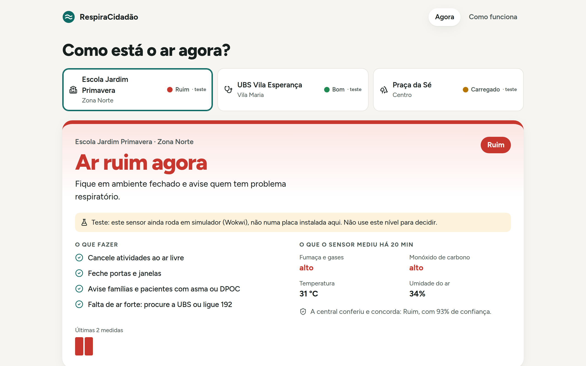
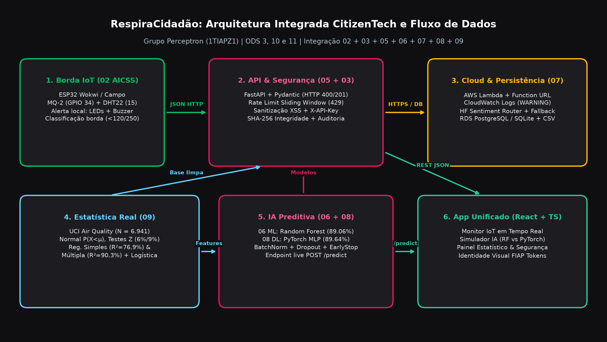
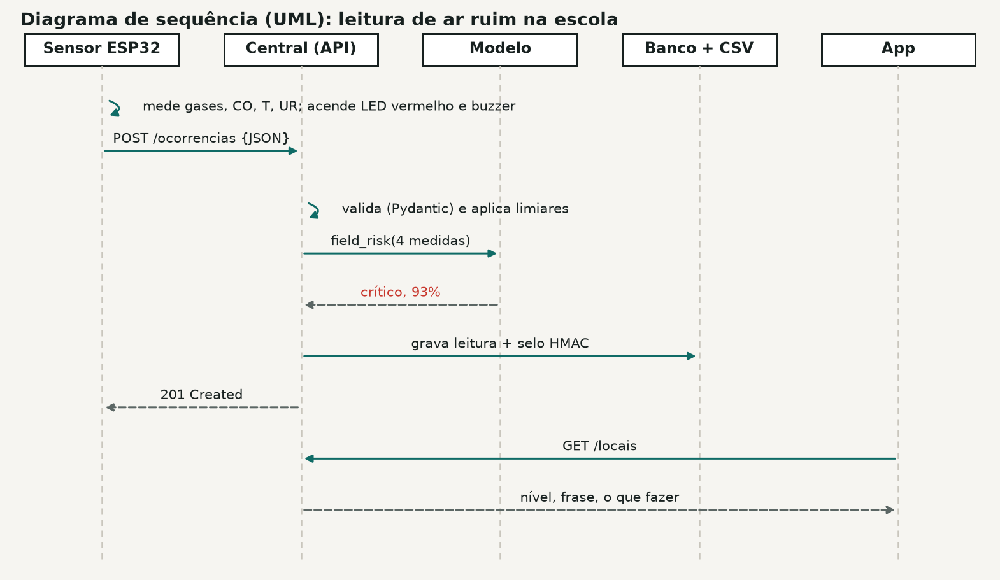

# RespiraCidadão

Sistema de monitoramento local da qualidade do ar para escolas, postos de saúde e bairros longe de estações oficiais. Um sensor de baixo custo mede gases, temperatura e umidade, aciona alerta luminoso e sonoro no local mesmo sem internet e envia a leitura para uma central em Python. A central valida os dados, classifica o risco com modelos treinados em 6.941 horas reais de medição e exibe no aplicativo web o nível do ar, o melhor horário do dia e orientações práticas.



## Arquitetura e diagramas UML

O sistema é dividido em cinco blocos que compartilham o mesmo contrato JSON de leitura: sensor no local, central em Python, modelos de IA, aplicativo web e espelho serverless para nuvem AWS.



### Fluxo de uma leitura, diagrama de sequência UML



### Como funciona passo a passo

1. **Coleta e alerta offline no sensor.** O firmware do ESP32 lê quatro grandezas ambientais: fumaça e gases (`gas_voc`), monóxido de carbono (`gas_co`), temperatura em °C e umidade relativa em %. Antes mesmo de tentar enviar pela rede, o próprio dispositivo compara as leituras com os limiares locais e acende LED verde, amarelo ou vermelho, tocando o buzzer quando o ar piora.
2. **Validação e classificação na central.** O envio chega via `POST /ocorrencias` na API FastAPI em `apps/api`. A central valida tipos, faixas numéricas e data da medição. Em seguida, calcula o risco pela regra de limiar e confere o resultado com o modelo Random Forest treinado sobre as mesmas quatro variáveis do sensor.
3. **Integridade, persistência e segurança.** Cada ocorrência aprovada recebe um selo criptográfico HMAC-SHA256 e é gravada em SQLite e CSV. O sistema bloqueia excesso de envios por minuto, higieniza textos contra injeção de HTML e exige chave de API para rotas administrativas de auditoria e limpeza.
4. **Segunda opinião e transparência.** Uma rede neural independente em PyTorch roda sobre as mesmas quatro entradas na aba "Como funciona", permitindo simular qualquer combinação de leitura ao vivo e comparar o veredito do sensor, da Random Forest e da rede neural.
5. **Visualização e relatos anônimos.** O aplicativo React consulta `GET /locais` e `GET /padrao-horario` para mostrar a cor do alerta, ações recomendadas e o melhor horário do dia. Moradores também podem registrar relatos de fumaça ou cheiro forte sem informar nome nem localização; a central sinaliza urgência separadamente da leitura do sensor.

### Espelho serverless na AWS

A pasta [`packages/cloud-serverless`](packages/cloud-serverless/README.md) implementa a mesma ingestão em arquitetura sob demanda com AWS Lambda, Function URL, Amazon RDS PostgreSQL 18.3 e Amazon CloudWatch. A publicação foi validada no AWS Academy Learner Lab e as capturas reais estão em `docs/evidencias/`. Como sessões do Learner Lab expiram ao fim do laboratório, o pacote inclui um servidor local (`servidor_local.py`) e o script `./deploy_aws.sh` para testar offline ou republicar quando necessário.

## Limiares de risco e desempenho dos modelos

Os cortes foram calibrados com base em 6.941 horas completas da base pública UCI Air Quality, usando o monóxido de carbono medido em laboratório como referência oficial de classe:

| Nível no app | Faixa de `gas_voc` | Faixa de `gas_co` | Ação local no sensor |
|---|---|---|---|
| Bom, `normal` | Abaixo de 830 | Abaixo de 1010 | LED verde, buzzer silencioso |
| Carregado, `atencao` | 830 a 1139 | 1010 a 1279 | LED amarelo, bipe curto |
| Ruim, `critico` | 1140 ou mais | 1280 ou mais | LED vermelho, alarme periódico |

Resultados medidos na base de teste, sempre usando apenas as quatro variáveis do sensor:

- **Regra fixa no sensor:** 84% de acerto, operando mesmo sem internet.
- **Modelo principal, Random Forest:** 87% de acerto no teste e 85% quando avaliado em meses futuros não vistos no treino. Em 1.389 horas de teste, nenhuma hora de ar bom foi confundida com ar ruim, nem o inverso.
- **Segunda opinião, rede neural PyTorch:** 86% de acerto no teste, com diferença de 1,1 ponto percentual entre treino e teste.
- **Estatística inferencial:** regressão linear múltipla com as quatro medidas explica 88% da variação do monóxido de laboratório.

Limites conhecidos: o sensor opera hoje em simulação no Wokwi e a base de referência foi coletada em uma cidade italiana. Antes de uso em campo em um bairro novo, a placa física precisa ser montada e recalibrada por algumas semanas ao lado de uma estação oficial como a da CETESB.

## Estrutura do repositório

| Caminho | Conteúdo |
|---|---|
| `apps/api` | API FastAPI: ingestão, validação, modelos ML e PyTorch, segurança HMAC, SQLite e CSV. |
| `apps/web` | Aplicativo web em React, TypeScript e Vite com as abas "Agora" e "Como funciona". |
| `packages/iot-aicss` | Firmware ESP32, circuito Wokwi, receptor CSV e simulador de três cenários. |
| `packages/cloud-serverless` | Função AWS Lambda, SQL do RDS PostgreSQL, simulador HTTP, servidor local e script de deploy. |
| `packages/ml-modelling` | Notebook e artefatos da comparação entre seis modelos de classificação. |
| `packages/neural-networks` | Notebook, pesos salvos e métricas da rede neural em PyTorch. |
| `packages/stats-r-python` | Script estatístico completo com testes de hipótese, regressões e gráficos. |
| `packages/data-science-oracle` | Consultas SQL em Oracle para a entrega individual de Data Science. |
| `data` | Base UCI Air Quality bruta e limpa; dados em tempo de execução ficam em `data/runtime`. |
| `docs` | Diagramas, relatórios FIAP em PDF e DOCX, slides, capturas da AWS e guias de entrega. |
| `deliverables` | Pacotes `.zip` prontos para envio em cada disciplina. |

## Como instalar e testar localmente

### Pré-requisitos

- Python 3.11 ou superior
- Node.js 20 ou superior com npm

### 1. Subir a central, porta 8000

```bash
python3 -m venv .venv
.venv/bin/pip install -e apps/api
export RESPIRA_API_KEY="chave-local-admin"
.venv/bin/uvicorn app.main:app --app-dir apps/api --port 8000
```

Variáveis opcionais:

- `RESPIRA_API_KEY`: habilita as rotas administrativas `GET /security/audit` e `DELETE /ocorrencias`. Sem ela, essas rotas ficam bloqueadas.
- `RESPIRA_SEAL_KEY`: chave para o selo HMAC. Se omitida, a central gera uma chave local automaticamente em `data/runtime/seal.key`.
- `HF_TOKEN`: token de leitura da Hugging Face para análise de sentimento em relatos. Sem ele, a classificação de urgência funciona normalmente por palavras-chave locais.

A documentação interativa da API fica disponível em `http://127.0.0.1:8000/docs`.

### 2. Subir o aplicativo web, porta 5173

Em outro terminal:

```bash
cd apps/web
npm install
npm run dev
```

Abra `http://127.0.0.1:5173`. O servidor Vite redireciona automaticamente chamadas de `/api` para `http://127.0.0.1:8000`.

### 3. Popular leituras e testar os três níveis

Você pode gerar dados de duas formas:

- **Pelo navegador:** clique em "Modo demonstração" no rodapé da tela e dispare leituras de nível Bom, Carregado ou Ruim para cada lugar.
- **Pelo terminal, simulando os sensores:**

```bash
.venv/bin/python packages/iot-aicss/run_3_cenarios.py
```

O script envia três leituras reais para a central: ar bom na UBS Vila Esperança, ar carregado na Praça da Sé e ar ruim na Escola Jardim Primavera.

### 4. Testar a versão serverless localmente, sem AWS

Em outro terminal, sem precisar de conta na AWS:

```bash
.venv/bin/python packages/cloud-serverless/servidor_local.py
```

Depois envie leituras simuladas para o servidor local na porta 8099:

```bash
FUNCTION_URL=http://127.0.0.1:8099 .venv/bin/python packages/cloud-serverless/simulador_dispositivo.py --cenario queimada --lugar escola --leituras 5
```

## Rotas principais da API local

| Método e rota | Função |
|---|---|
| `GET /health` | Verifica status da API, modelos carregados e se a IA externa está ativa. |
| `POST /ocorrencias` | Recebe leitura do sensor, valida, classifica e grava com selo HMAC. |
| `GET /locais` | Lista os locais monitorados com última leitura, nível atual e relatos. |
| `GET /padrao-horario` | Retorna o histórico horário calculado sobre as 6.941 horas reais. |
| `POST /relatos` | Registra relato anônimo de morador com sanitização e detecção de urgência. |
| `POST /predict` | Simula qualquer leitura nos controles da aba "Como funciona" sem gravar no banco. |
| `GET /security/verify/{id}` | Confere se o selo HMAC do registro continua íntegro. |
| `GET /security/audit` | Lista eventos de auditoria de segurança; exige cabeçalho `X-API-Key`. |
| `DELETE /ocorrencias` | Limpa registros de teste; exige cabeçalho `X-API-Key`. |

## Testes automatizados e build

```bash
.venv/bin/pip install pytest httpx
.venv/bin/pytest apps/api/tests -q
.venv/bin/python packages/cloud-serverless/teste_local.py
npm --prefix apps/web run build
```

Os comandos acima validam os 24 testes da central e de segurança, as 8 verificações da função serverless em modo local e a compilação de produção do frontend.

## Documentação complementar

- [Guia de entregas e roteiros de vídeo](docs/ENTREGAS.md)
- [Plano técnico do produto](docs/PLANO-PRODUTO.md)
- [Detalhes da pilha serverless na AWS](packages/cloud-serverless/README.md)
- [Circuito e simulação IoT no Wokwi](packages/iot-aicss/README.md)
